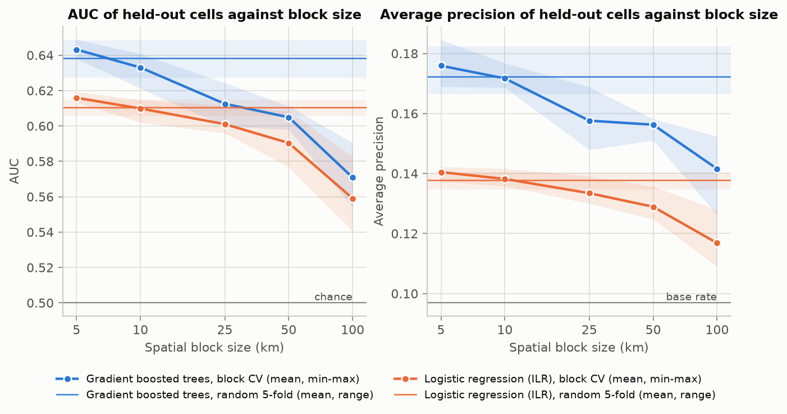

# Mineral Prospectivity: how much of a model's skill is spatial leakage?

_Rendered from `README.tmpl.md` by `scripts/90_render_docs.py`; every number is a ledger value. Edit the template, not this file._

**Question.** Given USGS NURE stream-sediment geochemistry over Nevada aggregated to {{features.cell_km:g}} km cells, how well can cells containing a known gold producer (MRDS Producer or Past Producer with gold as a primary commodity) be predicted, and how much of that apparent skill disappears when cross-validation respects spatial structure?

**Answer.** Most of it. The gradient boosted model's AUC is {{cv.hgb.random.auc.mean:.3f}} under random {{cv.k_outer}}-fold CV (range {{cv.hgb.random.auc.min:.3f}} to {{cv.hgb.random.auc.max:.3f}} over {{cv.n_repetitions}} repetitions) and {{cv.hgb.ref.auc.mean:.3f}} under {{headline.reference_block_km:g}} km spatial block CV (range {{cv.hgb.ref.auc.min:.3f}} to {{cv.hgb.ref.auc.max:.3f}}), the block size the pre-registered autocorrelation rule selected. Average precision falls from {{cv.hgb.random.ap.mean:.3f}} to {{cv.hgb.ref.ap.mean:.3f}} against a base rate of {{cv.base_rate_pct:.1f}} percent. Under the frozen decision rule the leakage is "{{headline.hgb.leakage_label}}" and at the reference block size there is "{{headline.hgb.skill_label}}". Leaving out an entire analytical laboratory family is worse still (AUC {{batch.hgb.lofo.auc:.3f}}), and adding the family as a covariate raises random-CV AUC by {{explore.labcov.hgb.random_gain:.3f}}: the model can learn the lab. The elements that carry what signal there is ({{explore.contrast_most_enriched}} up; {{explore.contrast_most_depleted}} down) describe lithology, not ore.



Full report: [`reports/report.md`](reports/report.md). Pre-registration (frozen before any model was fitted): [`docs/prereg.md`](docs/prereg.md). Decisions: [`docs/decisions.md`](docs/decisions.md). Five-minute walkthrough: [`docs/walkthrough.md`](docs/walkthrough.md).

## Headline numbers

| | Boosted trees | Logistic regression |
|---|---|---|
| AUC, random {{cv.k_outer}}-fold (mean, min to max) | {{cv.hgb.random.auc.mean:.3f}} ({{cv.hgb.random.auc.min:.3f}} to {{cv.hgb.random.auc.max:.3f}}) | {{cv.lr.random.auc.mean:.3f}} ({{cv.lr.random.auc.min:.3f}} to {{cv.lr.random.auc.max:.3f}}) |
| AUC, {{headline.reference_block_km:g}} km blocks | {{cv.hgb.ref.auc.mean:.3f}} ({{cv.hgb.ref.auc.min:.3f}} to {{cv.hgb.ref.auc.max:.3f}}) | {{cv.lr.ref.auc.mean:.3f}} ({{cv.lr.ref.auc.min:.3f}} to {{cv.lr.ref.auc.max:.3f}}) |
| Average precision, random / blocks | {{cv.hgb.random.ap.mean:.3f}} / {{cv.hgb.ref.ap.mean:.3f}} | {{cv.lr.random.ap.mean:.3f}} / {{cv.lr.ref.ap.mean:.3f}} |
| Positives captured in top ten percent, random / blocks | {{cv.hgb.random.capture_10.mean:.1%}} / {{cv.hgb.ref.capture_10.mean:.1%}} | {{cv.lr.random.capture_10.mean:.1%}} / {{cv.lr.ref.capture_10.mean:.1%}} |
| Positives captured in top five percent, random / blocks | {{cv.hgb.random.capture_5.mean:.1%}} / {{cv.hgb.ref.capture_5.mean:.1%}} | {{cv.lr.random.capture_5.mean:.1%}} / {{cv.lr.ref.capture_5.mean:.1%}} |
| Leave-one-method-family-out AUC | {{batch.hgb.lofo.auc:.3f}} | {{batch.lr.lofo.auc:.3f}} |
| Leave-one-quadrangle-out AUC (pooled) | {{batch.hgb.loqo.auc:.3f}} | {{batch.lr.loqo.auc:.3f}} |

Population: {{labels.n_cells}} cells, {{labels.n_positive_cells}} positive, from {{prep.n_samples}} stream-sediment samples and {{labels.n_positive_sites}} producer sites. Moran's I of the label is {{moran.i_bin1:.2f}} within {{moran.i_bin1_hi_km:g}} km and falls below {{moran.threshold:g}} beyond {{moran.range_km:g}} km.

## Setup

Requires Python 3.12 and [uv](https://docs.astral.sh/uv/). The baseline harness
is cairn commit `a184e0732989373856039dea2919ccd96a88e8b1`. Install it in a
dedicated sibling without changing an existing cairn checkout:

```bash
git clone https://github.com/ethannol/cairn.git ../cairn-mineral-baseline
git -C ../cairn-mineral-baseline checkout --detach a184e0732989373856039dea2919ccd96a88e8b1
uv sync
```

The path dependency points to this dedicated checkout. If it already exists,
verify its HEAD matches the hash above before syncing; do not reset a shared
working tree. The project lockfile pins the remaining packages.

## Commands

Deterministic, no network, from the committed extract:

```bash
uv run cairn run               # scripts/10 .. 90 in order; rebuilds artifacts/numbers.json
uv run cairn render            # reports/report.md from report.tmpl.md and the ledger
uv run cairn verify            # all sensors, including the clean re-execution
uv run pytest                  # tests (log-ratio, blocks, label join, censoring, capture, synthetic leakage)
uv run python -m prospectivity.extract --check   # recompute the extract from the archives (needs data/archive/)
```

Network (only to re-download the archives; the extract is committed):

```bash
uv run python -m prospectivity.acquire           # downloads both archives to data/archive/, saves headers
uv run python -m prospectivity.acquire --verify  # SHA-256 against data/raw/manifest.json
```

## Data provenance

- NURE HSSR sediment database, whole-country CSV: https://mrdata.usgs.gov/nure/sediment/nuresed-csv.zip (public domain), retrieved 2026-10-09; {{extract.nure_rows}} Nevada sediment rows extracted from the full table. Metadata: `data/raw/nurehssr.met`.
- MRDS flattened CSV: https://mrdata.usgs.gov/mrds/mrds-csv.zip (public domain), retrieved 2026-10-09; {{extract.mrds_rows}} Nevada rows. Metadata: `data/raw/mrds.met`.
- URLs, HTTP response headers, archive SHA-256, row counts and extract SHA-256: `data/raw/manifest.json`. The archives (about 65 MB) are not committed; the extract is written once by `prospectivity.extract` as verbatim text rows and never modified. Field definitions and quirks: `docs/data_dictionary.md`.

## What is not claimed

- No exploration recommendation. The held-out ranking at the reference block size does not meet the pre-registered skill rule, probabilities sit in a narrow band around the base rate, and the negatives are unlabelled cells, not known-barren ground.
- No pathfinder geochemistry. The ten-element suite common to the three analytical method families is lithological; As, Sb, Hg, W and Tl were not measured consistently and were excluded by the frozen rule.
- No separation of laboratory from region: the method families occupy different quadrangles, so the batch effect and the regional effect are confounded in these data.
- No confidence intervals: the reported spread is across repetitions of the fold allocation and block offset.

## How AI was used

This project was built in a Claude Code session with Claude Fable 5.1 from a written brief, under the cairn harness: the agent downloaded and profiled the data, chose the region after inspecting both candidates, wrote the pre-registration and froze it before fitting anything, wrote the pipeline, tests, figures and report, and ran `cairn verify` including the clean re-execution. The author reviewed the pre-registration, the tests and the findings. Every number in the report, this README and the walkthrough is a ledger value produced by a script; none was typed by hand.

## Layout

```
data/raw/            committed extract, metadata, manifest (frozen; never modified)
data/archive/        downloaded archives (gitignored)
data/derived/        sample, cell and prediction tables (regenerated; parquet gitignored)
src/prospectivity/   acquire, extract, prepare, features, labels, cv, models, util
scripts/             10 prepare, 20 features, 30 labels, 40 autocorrelation, 50 cv,
                     60 batch checks and exploratory, 70 interpret, 80 figures, 90 render docs
artifacts/           numbers.json (ledger), checks.jsonl
reports/             report.md (rendered), figures/, tables/
profiles/            cairn profile output for the two extracts
docs/                prereg.md (frozen), decisions.md, data_dictionary.md, walkthrough.md,
                     resume_bullet.md, cairn_trap_task.md
tests/               pytest suite
```


The frozen skill label is an operational decision rule, not a statistical test that AUC equals 0.5. The reference model does not meet the pre-registered useful-skill threshold. Family indicators are learnable proxies for both method and region; this dataset cannot isolate a causal laboratory effect. See [the supplementary distance-buffer sensitivity](docs/buffered-validation.md) for a stricter exploratory separation check.
